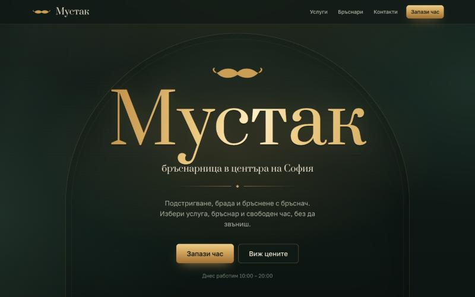
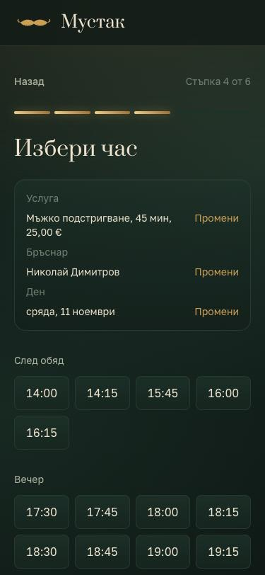
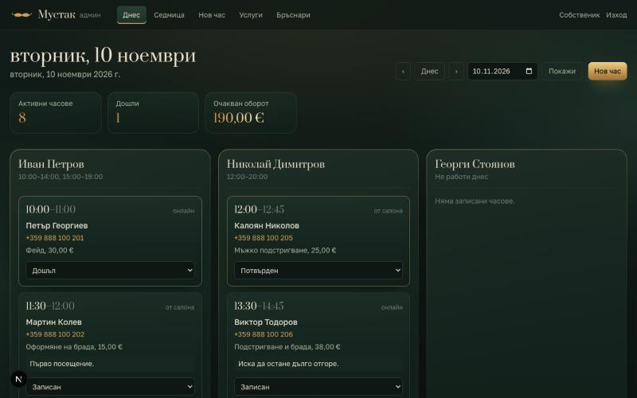

# Мустак: онлайн записване за бръснарница



> Целият проект е направен за около час с [Claude Code](https://claude.com/claude-code): от празна папка до работещ Docker стек с тестове. Заданието, планът, стъпките и проблемите по пътя са описани в **[Как го направихме](docs/how-we-built-it.md)**, за да може да се повтори.

Уеб приложение за бръснарница „Мустак“ (измислен бизнес):

- **Публичен сайт** на български: услуги и цени в евро, бръснари, работно време, контакти и записване на час в 6 стъпки от телефона.
- **Админ панел** (`/admin`): графикът за деня и седмицата, статуси на часовете, ръчно добавяне на час, услуги, бръснари, работно време и почивни дни.
- **API за AI агент** (`/api/v1`): свободни часове, записване и списък с услугите, защитено с таен ключ.

Всичко работи на собствен сървър: Next.js + PostgreSQL в Docker. Няма външни услуги за данни, вход, анализи, карти или шрифтове. Единственото изключение е по избор: проверката „Не съм робот“ на Cloudflare Turnstile при записване (вижте [Защита от ботове](#защита-от-ботове-cloudflare-turnstile)).

Името, адресът, контактите и правилата за записване се сменят в един файл: [`src/config/business.ts`](src/config/business.ts).

## Бърз старт с Docker

Нужни са Docker и Docker Compose.

```bash
cp .env.example .env
```

Отворете `.env` и попълнете `POSTGRES_PASSWORD`, `ADMIN_PASSWORD` и `AGENT_API_KEY`. Случайни стойности се генерират така:

```bash
openssl rand -hex 24
```

После:

```bash
docker compose up --build
```

При всяко стартиране контейнерът прилага миграциите и зарежда началните данни, ако липсват. При първото пускане това са администраторът и примерните данни: 6 услуги, 3 бръснари, работно време и няколко часа за днес и следващите два дни.

- Сайт: http://localhost:3000
- Админ панел: http://localhost:3000/admin (имейл и парола от `ADMIN_EMAIL` / `ADMIN_PASSWORD`)

**От телефон в същата мрежа** отворете `http://<IP-то на компютъра>:3000`. Задайте същия адрес в `APP_URL`, за да са верни линковете за отказ в отговорите на API-то.

Данните се пазят във volume `pgdata`. Пълно нулиране (изтрива всички данни): `docker compose down -v`.

## Администратор

- Първият администратор се създава при първото зареждане на данни от `ADMIN_EMAIL`, `ADMIN_PASSWORD` (поне 12 символа) и `ADMIN_NAME`, само ако в базата още няма администратор. След това паролата може да се махне от `.env`.
- Паролите се пазят само като argon2id хеш. Сесията е случаен токен в httpOnly бисквитка, а в базата е само неговият SHA-256. Бисквитката получава флаг `Secure`, когато `APP_URL` започва с `https://`.
- Смяна на забравена парола (или нов администратор): задайте новата парола в `ADMIN_PASSWORD` в `.env` и пуснете:

  ```bash
  docker compose run --rm --entrypoint node app scripts/admin-password.mjs
  ```

  Локално: `npm run admin:password`. Всички стари сесии на този администратор се прекратяват.

## Локална разработка

Нужни са Node.js 22+ и Docker (за базата).

```bash
npm install
cp .env.example .env   # попълнете паролите; DATABASE_URL сочи към localhost:5433
npm run db:up          # Postgres само на 127.0.0.1:5433
npm run db:migrate
npm run db:seed
npm run dev            # http://localhost:3000
```

| Команда | Какво прави |
| --- | --- |
| `npm run dev` | dev сървър |
| `npm run build` | production build (standalone) |
| `npm test` | unit + интеграционни тестове (интеграционните вдигат Postgres в Docker) |
| `npm run test:unit` | само unit тестове, без Docker |
| `npm run lint` / `npm run typecheck` | ESLint / TypeScript |
| `npm run db:generate` | нова миграция след промяна в `src/server/db/schema.ts` |
| `npm run db:migrate` / `npm run db:seed` | миграции / начални данни |
| `npm run admin:password` | смяна на парола на администратор |

Интеграционните тестове стартират `postgres:18-alpine` с Testcontainers. Без Docker задайте `TEST_DATABASE_URL` към празна тестова база. Тестовете я изчистват!

## Как се пази от двойно записване

В базата има ограничение, което не позволява два активни часа на един бръснар да се припокриват:

```sql
EXCLUDE USING gist (barber_id WITH =, tstzrange(starts_at, ends_at, '[)') WITH &&)
  WHERE (status IN ('booked', 'confirmed', 'arrived'))
```

Дори два клиента да натиснат „Потвърди“ в една и съща милисекунда, базата приема само единия. Другият получава „Този час току-що беше зает“ и нов списък със свободни часове. При „Първият свободен“ системата пробва следващия свободен бръснар. Отказаните и неявилите се часове не заемат времето. Тестът `tests/integration/booking.test.ts` пуска 20 едновременни заявки за един час и проверява, че минава точно една.

Всички часове се пазят в UTC и се показват и изчисляват в `Europe/Sofia`, включително в дните, когато се сменя лятното и зимното време.

## API за AI агента

Всички заявки изискват хедър `X-API-Key` със стойността на `AGENT_API_KEY` (поне 32 символа). Ако ключът не е зададен, API-то връща `503` и е изключено. Endpoint-ите ползват същата бизнес логика като сайта.

Примерите приемат `BASE=http://localhost:3000` и `KEY=<AGENT_API_KEY>`.

### Списък с услугите

```bash
curl -s -H "X-API-Key: $KEY" "$BASE/api/v1/services"
```

```json
{
  "services": [
    {
      "id": "6f0c…",
      "name": "Мъжко подстригване",
      "description": "Консултация, измиване, подстригване…",
      "durationMinutes": 45,
      "price": "25.00",
      "priceCents": 2500,
      "currency": "EUR"
    }
  ]
}
```

### Бръснари

```bash
curl -s -H "X-API-Key: $KEY" "$BASE/api/v1/barbers"
```

Връща `id`, `name`, `bio` и `workingWeekdays` (1 = понеделник … 7 = неделя).

### Свободни часове

```bash
curl -s -H "X-API-Key: $KEY" \
  "$BASE/api/v1/availability?serviceId=<id>&date=2026-11-12&barberId=<id>"
```

`barberId` не е задължителен: без него се връщат часовете при всички бръснари.

```json
{
  "date": "2026-11-12",
  "timezone": "Europe/Sofia",
  "service": { "id": "6f0c…", "name": "Мъжко подстригване", "durationMinutes": 45, "price": "25.00", "priceCents": 2500, "currency": "EUR" },
  "barberId": null,
  "slots": [
    {
      "start": "2026-11-12T10:00:00+02:00",
      "end": "2026-11-12T10:45:00+02:00",
      "time": "10:00",
      "barbers": [{ "id": "b1…", "name": "Иван Петров" }, { "id": "b3…", "name": "Георги Стоянов" }]
    }
  ]
}
```

### Записване на час

```bash
curl -s -X POST "$BASE/api/v1/bookings" \
  -H "X-API-Key: $KEY" \
  -H "Content-Type: application/json" \
  -H "Idempotency-Key: n8n-execution-12345" \
  -d '{
    "serviceId": "<id>",
    "barberId": "<id или null за първия свободен>",
    "start": "2026-11-12T10:00",
    "customer": { "name": "Петър Петров", "phone": "0888 123 456", "email": "petar@example.com" },
    "note": "Записан от AI агента"
  }'
```

- `start` е `start` от свободните часове (ISO с отместване) или местно време в София без отместване (`2026-11-12T10:00`).
- Телефонът се нормализира до `+359…`. Имейлът и бележката не са задължителни.
- `Idempotency-Key` не е задължителен, но се препоръчва. Повторна заявка със същия ключ (напр. повторен опит от n8n) връща вече създадения час със статус `200` и `"replayed": true`, вместо да създаде втори.

Отговор `201`:

```json
{
  "booking": {
    "id": "a7e1…",
    "status": "booked",
    "start": "2026-11-12T10:00:00+02:00",
    "end": "2026-11-12T10:45:00+02:00",
    "date": "2026-11-12",
    "time": "10:00",
    "timezone": "Europe/Sofia",
    "service": { "id": "6f0c…", "name": "Мъжко подстригване", "durationMinutes": 45, "price": "25.00", "priceCents": 2500, "currency": "EUR" },
    "barber": { "id": "b1…", "name": "Иван Петров" },
    "customer": { "name": "Петър Петров", "phone": "+359888123456", "email": "petar@example.com" },
    "note": "Записан от AI агента",
    "cancelUrl": "http://localhost:3000/chas/Xy3…"
  },
  "replayed": false
}
```

`cancelUrl` е личният линк на клиента. През него той вижда часа и може да го откаже. Агентът може да го изпрати на клиента. При повторена заявка (`replayed: true`) линкът не се връща отново, защото в базата се пази само хешът му.

### Грешки

Формат: `{ "error": { "code": "...", "message": "съобщение на български", "details": { ... } } }`.

| HTTP | code | Кога |
| --- | --- | --- |
| 400 | `INVALID_JSON` | тялото не е JSON |
| 401 | `UNAUTHORIZED` | липсва или грешен `X-API-Key` |
| 404 | `SERVICE_NOT_FOUND`, `BARBER_NOT_FOUND` | неактивна или несъществуваща услуга / бръснар |
| 409 | `SLOT_UNAVAILABLE` | часът е зает или извън работното време |
| 409 | `TOO_MANY_BOOKINGS` | телефонът вече има 3 бъдещи часа |
| 422 | `VALIDATION_ERROR` | невалидни данни, `details` е по полета |
| 422 | `DATE_OUT_OF_RANGE` | датата е в миналото или след 30 дни напред |
| 429 | `RATE_LIMITED` | твърде много заявки, вижте хедъра `Retry-After` |
| 503 | `API_DISABLED` | `AGENT_API_KEY` не е зададен |

### Лимити (rate limiting)

| Какво | Лимит |
| --- | --- |
| API, на IP (преди проверката на ключа) | 120 заявки / минута |
| API, на ключ | 60 заявки / минута |
| API записвания, на ключ | 10 / минута |
| Публична форма за записване, на IP | 5 / 10 минути (+ 60 / час общо и скрито поле срещу ботове) |
| Свободни часове от сайта, на IP | 60 / минута |
| Вход в админ панела | 5 опита / 15 минути на IP+имейл, 20 на IP |

Броячите са в PostgreSQL, затова работят и при няколко инстанции. Лимитите са в `src/server/rate-limit.ts`.

## Защита от ботове (Cloudflare Turnstile)

По избор на последната стъпка от записването („Провери и потвърди“) може да се показва проверката „Не съм робот“ на [Cloudflare Turnstile](https://developers.cloudflare.com/turnstile/). Тя спира автоматичните записвания, без да кара хората да разпознават картинки: в режим Managed повечето посетители минават без да натискат нищо.

Как работи:

1. Браузърът зарежда widget-а само на стъпката за потвърждение и получава еднократен токен.
2. Server Action-ът за записване първо валидира данните, после проверява токена на сървъра срещу `siteverify` на Cloudflare и чак тогава записва часа.
3. Приема се само `success: true` с действие `booking` и адрес на сайта от разрешените. Ако Cloudflare не отговори, записването се отказва (fail closed) с молба да се опита отново или да се обади в салона.
4. Всеки токен е за един опит. След неуспешен опит widget-ът се пресъздава с нов токен.

Включване:

1. В таблото на Cloudflare: **Turnstile → Add widget**, режим **Managed**, домейнът на сайта (за локален тест и `localhost`).
2. В `.env`:

   ```bash
   TURNSTILE_SITE_KEY=<site key>
   TURNSTILE_SECRET=<secret key>
   TURNSTILE_HOSTNAMES=mustak.example   # по подразбиране: адресът от APP_URL
   ```

3. Рестартирайте приложението (`docker compose up -d`).

За локален тест без акаунт ползвайте публичните тестови ключове на Cloudflare: `TURNSTILE_SITE_KEY=1x00000000000000000000AA` и `TURNSTILE_SECRET=1x0000000000000000000000000000000AA` (винаги минават) или `TURNSTILE_SECRET=2x0000000000000000000000000000000AA` (винаги отказва).

Без двата ключа защитата е изключена и сайтът не прави нищо към Cloudflare. API-то за AI агента и админ панелът не минават през Turnstile: те са защитени с ключ и с вход. Turnstile допълва, но не заменя лимитите на заявките, скритото поле срещу ботове и лимита от 3 бъдещи часа на телефон.

Поверителност: когато е включена, Cloudflare обработва технически данни от браузъра на посетителя на стъпката за потвърждение. Споменете го в политиката за поверителност на сайта.

## Продукция

- Пуснете приложението зад reverse proxy с HTTPS (Caddy, nginx) и задайте `APP_URL=https://…`. Пример с Caddy:

  ```
  mustak.example {
    reverse_proxy localhost:3000
  }
  ```

  Rate limiting-ът разпознава клиента по последния адрес в `X-Forwarded-For`, затова прокси сървърът трябва да задава този хедър (Caddy и nginx го правят).
- В контейнера приложението работи като потребител без root, с файлова система само за четене и без Linux capabilities. Postgres е във вътрешна Docker мрежа без публикуван порт и без достъп до интернет.
- Архив на базата:

  ```bash
  docker compose exec db pg_dump -U mustak mustak > backup.sql
  ```

## CI/CD (GitHub Actions)

Има два workflow-а в [`.github/workflows/`](.github/workflows/):

| Кога | Workflow | Какво прави |
| --- | --- | --- |
| Pull request към `main` | [`ci.yml`](.github/workflows/ci.yml) („Тестове“) | Lint, проверка на типовете, unit и интеграционни тестове (истински PostgreSQL през Testcontainers) и `npm run build`. Нищо не се публикува. |
| Commit в `main` | [`docker-publish.yml`](.github/workflows/docker-publish.yml) („Docker образ“) | Пуска същите проверки, после прави Docker образа (linux/amd64) и го качва в GitHub Container Registry. Ако проверките паднат, образът не се публикува. |

Не трябват тайни: публикуването ползва вградения `GITHUB_TOKEN` с право `packages: write`. Всяко действие (action) е закачено към конкретен commit (SHA), а не към таг, който може да се премести.

Образът е `ghcr.io/martin-key/mustak` (във fork: `ghcr.io/<вашият-акаунт>/<repo>`) и има два тага:

- `latest`: последният commit в `main`;
- `sha-<първите 7 знака от commit-а>`: конкретна версия, за връщане назад.

**Пускане на сървъра без build.** В `docker-compose.yml` при услугата `app` заменете редовете `build: .` и `image: mustak-app:latest` с:

```yaml
    image: ghcr.io/martin-key/mustak:latest
```

После:

```bash
docker compose pull && docker compose up -d
```

Миграциите се прилагат автоматично при стартиране. За конкретна версия сменете `latest` с `sha-…`.

**Еднократни настройки в GitHub:**

- След първото публикуване пакетът се вижда в профила (Packages → `mustak`). Ако е частен, сървърът влиза с `docker login ghcr.io` и personal access token с право `read:packages`. Публичен образ: Package settings → Change visibility → Public.
- За да не се слива PR с червени тестове, задайте правило за `main` (Settings → Rules → Rulesets или Settings → Branches) с „Require status checks to pass“ и проверката „Lint, типове, тестове, build“.

## Структура

```
src/
  config/business.ts       име, контакти, работно време на сайта, правила за записване
  app/(site)/              публичен сайт: начало, /zapazi-chas, /chas/[token]
  app/admin/               вход и админ панел
  app/api/v1/              API за AI агента
  app/api/public/          свободни часове за формата на сайта
  server/booking/          бизнес логиката: слотове, записване, отказ, управление
  server/db/               Drizzle схема, връзка, миграции, начални данни
  server/auth/             пароли и сесии
  lib/                     време (Europe/Sofia), валидация, форматиране
drizzle/                   SQL миграции (вкл. ограничението срещу двойно записване)
scripts/                   migrate, seed, смяна на парола
tests/unit, tests/integration
.github/workflows/         CI: тестове за pull request, Docker образ в GHCR от main
```

Подробните правила за разработка са в [CLAUDE.md](CLAUDE.md).

## Снимки

| Записване от телефон | Админ панел, „Днес“ |
| --- | --- |
|  |  |

## Лиценз

[MIT](LICENSE). „Мустак“ е измислен бизнес; адресът, телефоните и хората в примерните данни са измислени.
